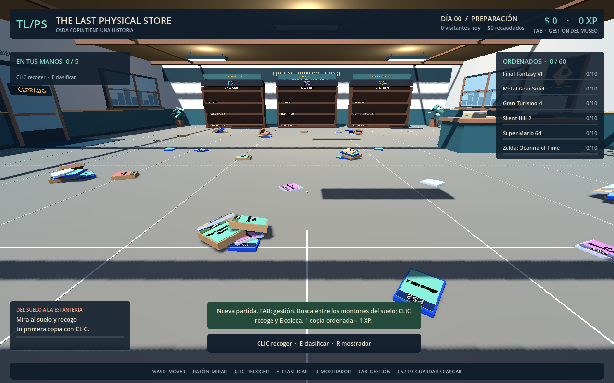
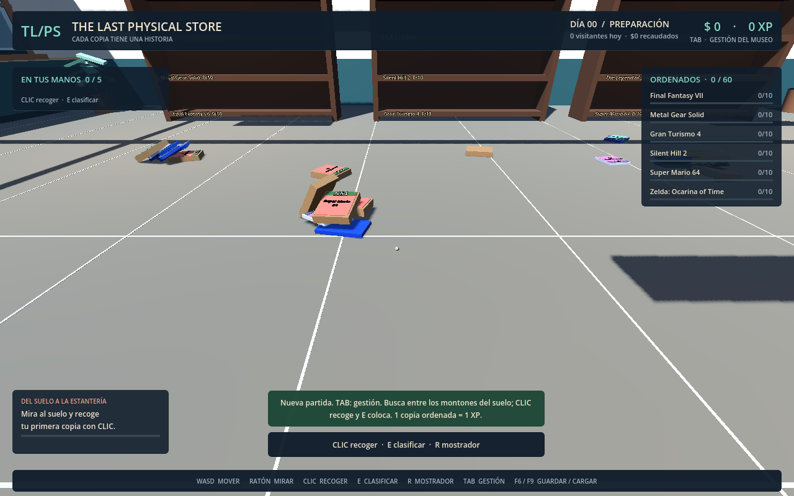

# Alpha 0.2.1 — Recoger del suelo y ordenar

Corrección después de la prueba del director: la distribución en mesas de Alpha
0.2 preclasificaba el stock y eliminaba la búsqueda. El centro del juego vuelve a
ser encontrar copias entre el desorden, recogerlas con inventario limitado y
colocarlas en las colecciones de las estanterías.

## Reglas vigentes

- Una sola tienda: se retiraron el tabique interior y las seis mesas.
- Las 60 copias comienzan mezcladas en siete montones irregulares y 18 cajas sueltas.
  Los montones mezclan títulos y plataformas, con orientaciones diferentes y cuerpos
  físicos que caen, se apoyan y descubren otras cajas al recoger las superiores.
- Hay diez copias de cada uno de los seis títulos: las colecciones se pueden completar.
- Recoger no da XP. Colocar correctamente una copia por primera vez da exactamente
  **1 XP**. Ordenar las 60 copias termina con **60 XP**.
- Completar una colección registra el hito sin añadir XP ni dinero.
- Los visitantes generan ingresos. Los costes monetarios y la jornada se conservan.
- Los requisitos de XP de inventario pasan a 5/20/40 y los de alcance a 5/15/30
  para que sean alcanzables con esta escala. La XP no se consume al comprar.
- Movimiento, salto, inventario inicial, formatos, identidades y slots se conservan.

Sort'em Ducks es la referencia de búsqueda y clasificación indicada por el director.
Esta corrección aplica su descripción y sus documentos; no presupone otras reglas
del juego de referencia. La consulta de su ficha pública de Steam no estuvo disponible
en este entorno (HTTP 403).

## Guardados

Los nuevos guardados usan JSON v3. La propiedad histórica `bodega` sigue nombrando
las copias del mundo para conservar el contrato; no requiere una segunda sala.

Al cargar v1 se conserva la distribución original y se calcula 1 XP por copia ya
exhibida. Al cargar v2, las copias pendientes de las antiguas mesas se mezclan en
el suelo conservando sus atributos. Inventario y estanterías no se redistribuyen.
La XP se recalcula con los IDs clasificados; dinero y mejoras anteriores se conservan.

Se respalda el original antes de migrar en `partida_01_sprint07_original.json` o
`partida_01_alpha02_original.json`. Los guardados v3 preservan posiciones, giros y
velocidades: cargar no vuelve a generar el desorden. Las ediciones booleanas no
se reinterpretan como GOTY/Collector. No se recibió un save histórico del usuario;
las migraciones se verifican con partidas de prueba de ambas versiones.

## Validación

`python3 Tools/run_checks.py`: **1563 comprobaciones Godot y 6 pruebas SQLite**.

La nueva prueba de suelo deja asentarse los cuerpos, verifica montones mezclados,
copias tapadas, ausencia de mesas/tabique y posiciones recuperadas al cargar.
Después recoge las 60 copias usando el raycast real del jugador y completa sus
estanterías. No mueve ni congela cajas, ni inserta copias artificialmente en el
inventario. Sitúa al jugador en puntos libres para comprobar accesibilidad; esto
no sustituye la prueba manual de desplazamiento y de la sensación de desorden.

Las capturas se renderizaron en Godot 4.6.3 con una partida nueva: todas las copias
siguen en el suelo, sin colecciones rellenadas como preparación de la imagen.

## Alcance

Esta entrega corrige el núcleo de la alpha de 60 copias. La escala de cientos o
miles, el arte final, las reglas abiertas de excedentes y ediciones, archivo y
reemplazos siguen pendientes. La aprobación de la densidad y sensación de ordenar
corresponde al director después de jugar esta corrección.
